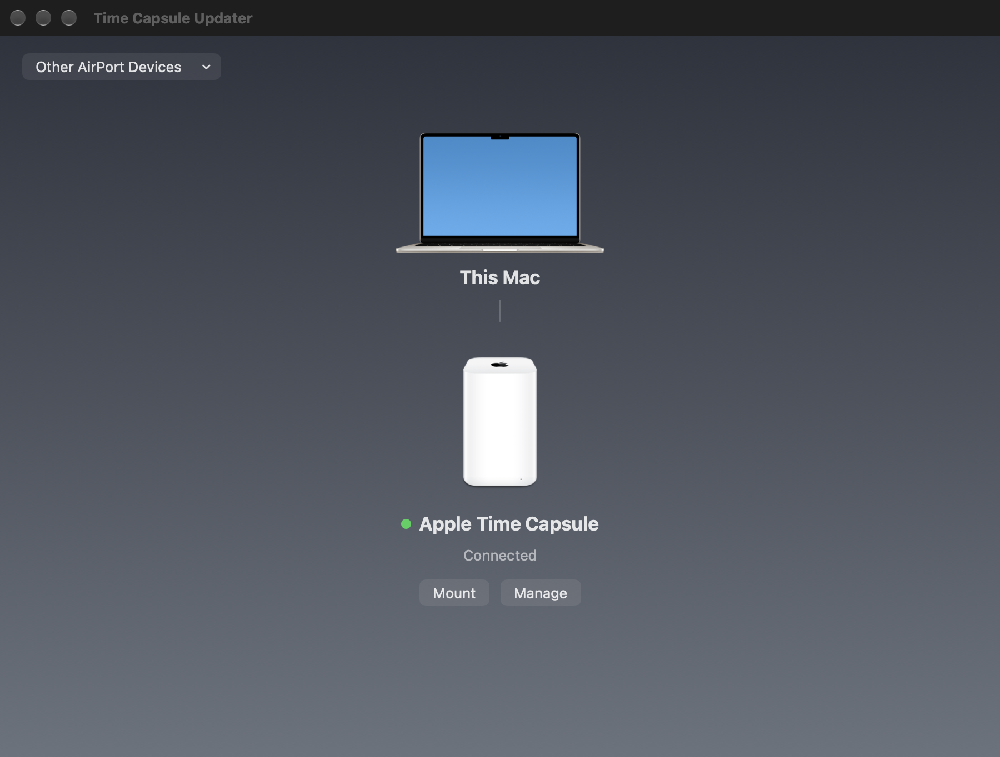
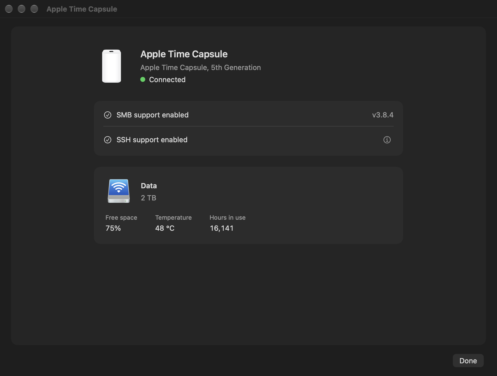

# Time Capsule Updater

Modern SMB file sharing for your Apple Time Capsule, with a simple Mac app to install updates, enable SSH and check disk health.

The software runs on the AirPort itself. Once set up, you can use its storage from Finder and Time Machine without keeping the app open.

## What you need

- A Mac running macOS 14 or later.
- An Apple Time Capsule on the same local network, and its base station password.
- For AirPort Extreme devices with USB storage, check the [supported models](FAQ.md#what-airport-extreme-models-are-supported).

[Download the macOS app](https://github.com/jamesyc/TimeCapsuleSMB/releases), open the disk image and move the app to Applications.

**Preview:** The screenshots and instructions below describe the redesigned app on this branch. Current upstream releases still use the older TimeCapsuleSMB name and interface; use a preview build for this design.

## Get started

1. Open **Time Capsule Updater** and allow **Local Network** access when macOS asks.
2. Choose **Add an AirPort…**, or select your device from **Other AirPort Devices**. Use **Add by Address…** if it is not discovered.
3. Select the device, click **Continue**, enter its **Base Station Password** and click **Connect**. Follow any prompts to enable SSH and restart the device. The password is saved in your Mac's Keychain after connecting.
4. Click **Manage**. If offered, choose **Set Up File Sharing** or **Update File Sharing** and follow the prompts. The device restarts during installation. If it already says **SMB support enabled** and no update is offered, you can use the disk.
5. Return to the home screen and click **Mount** to open the shared disk in Finder.

Use Ethernet during setup if restarting the AirPort would disconnect your Mac's Wi-Fi.

## One page for your device

Click **Manage** to see connection, support and disk information together.

- **SMB support** shows whether file sharing is enabled and offers an update when needed. Progress and Cancel appear in the same panel during installation.
- **SSH support** shows whether remote access is enabled. **Enable SSH** guides you through enabling it and confirming the device restart. Hover over the **ⓘ** button for connection instructions, or click it to keep the command open for copying. Click again to close it.
- **Disk information** shows capacity, the percentage of space free, temperature and hours in use where available. Important SMART problems show a warning and advice. Readings come from the last completed device check; some drives and connections cannot provide every reading.

Screenshots use example device data.

## Finder and Time Machine

**Mount** opens the SMB share in Finder. If Finder asks for a login, see the [shared-disk password guidance](FAQ.md#what-is-the-device-password-mode).

To use the disk for backups, select its SMB destination in **System Settings → General → Time Machine**. A normal install or update leaves existing files and backups in place. See the [FAQ about reusing backups](FAQ.md#can-i-keep-using-an-existing-time-machine-backup) before switching an existing destination.

## Help

If a device is missing, check that the Mac and AirPort are on the same network and that the app is allowed in **System Settings → Privacy & Security → Local Network**.

Older Time Capsules can need additional setup to start file sharing after a restart. See [model compatibility](FAQ.md#what-time-capsule-models-are-supported). Use AirPort Utility for Wi-Fi and network settings, and read the [account-password guidance](FAQ.md#can-i-use-an-airport-disk-sharing-accounts-password) for shared-disk accounts.

This project is designed for a trusted local network. For troubleshooting, start with the [FAQ](FAQ.md) or [report an issue](https://github.com/jamesyc/TimeCapsuleSMB/issues). Technical and command-line documentation is in [DETAIL.md](DETAIL.md).

Based on [TimeCapsuleSMB by jamesyc](https://github.com/jamesyc/TimeCapsuleSMB). You can [support the original project](https://buymeacoffee.com/jamesyc). See the [license](LICENSE).
